# Kame Apply

**Find real jobs worldwide, strengthen your resume with live market evidence, tailor each application, and apply faster, while you stay in control of every irreversible step.**

A multi-tenant job-search workbench: Tracks per role, scheduled discovery across ATS boards and public feeds, match scoring, scam safety checks, truthful resume studio and per-job tailoring, Answer Desk, assisted apply via browser extension or cloud runner, and a command center for the whole pipeline. Built as a **pnpm + Turborepo** (TypeScript) and **uv** (Python) monorepo: **Vue 3 + Nuxt 4** SPA, **FastAPI** (all business logic), **PostgreSQL 17** with **pgvector** and **RLS**, **DBOS** durable workflows, **PydanticAI**, and a **WXT** browser extension.

<p align="center">
  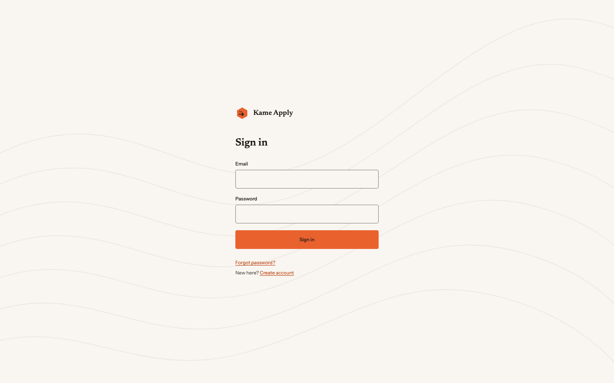
</p>

<p align="center">
  <a href="#features">Features</a> ·
  <a href="#screenshots">Screenshots</a> ·
  <a href="#tech-stack">Tech Stack</a> ·
  <a href="#getting-started">Getting Started</a> ·
  <a href="#documentation">Documentation</a>
</p>

<p align="center">
  
  
  
  
  
  
  
  
  
  
  
</p>

---

## Features

### Career Profile

- Upload resumes (PDF, DOCX, TXT) and portfolios; parse into structured facts with per-field confidence
- Guided profile interview to fill gaps (metrics, tools, scope, outcomes)
- **Answer bank** for forms: work authorization, notice period, salary, relocation, EEO defaults
- **Writing voice** from your own samples (emails, Slack, letters); free-text answers match your style
- Sensitive data (government IDs, bank) is never stored

### Tracks & criteria

- One **Track** per role (Software Developer, AI Engineer, Product Manager, …) with its own criteria, sources, schedule, autonomy, resume variant, and pipeline
- Hybrid criteria builder: describe the role in plain language, then edit structured chips and filters
- Live preview of estimated matches; AI suggestions for synonyms, skills, and noise filters
- Filters for titles, skills, seniority, remote/hybrid, salary, visa, company size, agencies, and more

### Job discovery & matching

- Scheduled pulls from company ATS APIs (Greenhouse, Lever, Ashby, Workable, …), remote boards, RSS, schema.org career pages, forwarded email alerts, and extension clips
- Normalize and dedupe across sources; expire closed posts; grow a company directory from public signals
- Hard filters → rule score → embeddings → LLM fit only for top candidates
- Per-job score, matched/missing skills, eligibility verdict, and salary/seniority fit

### Jobs board & safety

- Filterable research board: match score, risk badge, source, salary, location
- Shortlist, skip (trains ranking), hide company, mark applied, prepare, or open with assist
- **Risk levels** green / yellow / red with reasons; yellow/red pause automation
- PII guard on form fields; Check-this for recruiter messages and take-home links
- No CAPTCHA solvers, stealth plugins, or proxy rotation. Challenges hand control to you

### Resume Studio & Recruiter Lens

- Critique (ATS parseability, impact, keywords vs market), market insights from live postings
- Improve a base resume per Track; every change is a diff with a reason
- **Per-job tailor**: map posting requirements to Career Profile evidence; gaps stay gaps
- Recruiter Lens: parse check, qualification fit grades, knockout prediction, 7-second skim, authenticity
- ATS-safe PDF (Typst/RenderCV) and DOCX; optional cover letter in your voice

### Apply assist & Answer Desk

- Autonomy per Track: `discover` → `prepare` → `assist` (default) → opt-in `auto-submit` on allowlisted ATS only
- **Browser extension**: fill in your own session; LinkedIn/Indeed/JobStreet autofill is opt-in
- **Cloud runner**: headless apply with durable checkpoints, live view, and takeover
- You click Submit unless `auto-submit` policy allows it; never auto-submit on restricted platforms
- **Answer Desk**: paste questions, draft in your voice, copy; restricted questions get notes only

### Tracker, scheduling & agents

- Command center (Today): matches, Needs you inbox, Track cards, activity
- Pipeline: new → shortlisted → preparing → ready → in progress → needs you → submitted → interview → offer
- Per-Track schedules, quiet hours, daily caps, run history, notification prefs (in-app, email digest, push, Telegram)
- Bring-your-own AI keys (Gemini, OpenAI, Anthropic, Groq, OpenRouter, Ollama) with budgets
- **Claude Agent Bridge**: MCP server + Claude Code plugin so your own Claude works on workspace data (no credential relay)

---

## Screenshots

|                  Sign in                   |                 Today                  |
| :----------------------------------------: | :------------------------------------: |
|  | 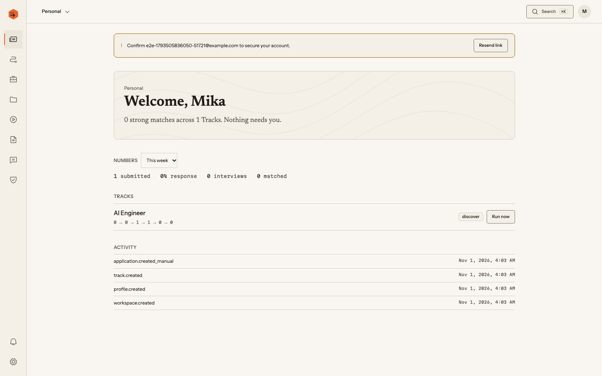 |

|                  Tracks                  |                      Criteria                      |
| :--------------------------------------: | :------------------------------------------------: |
| 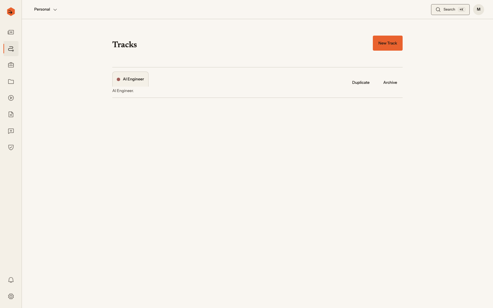 | 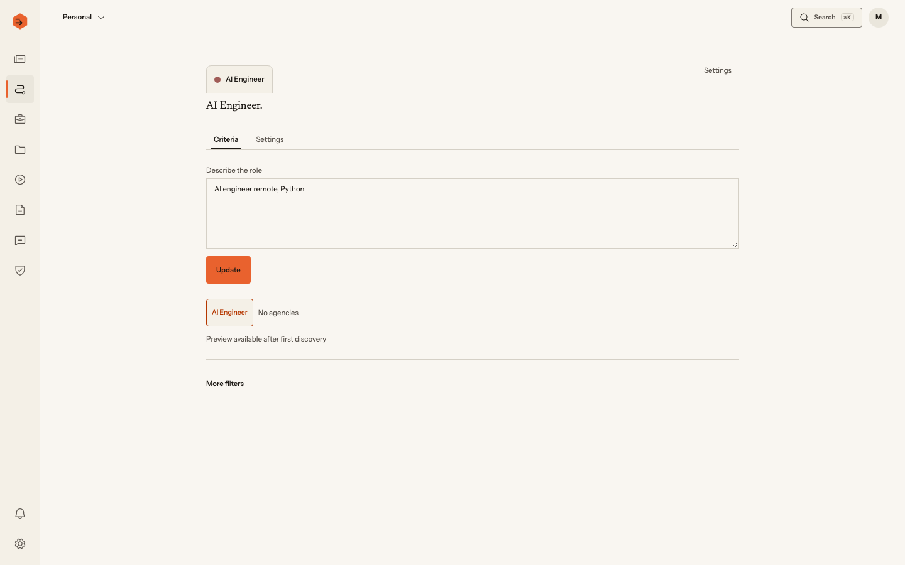 |

|                      Track settings                      |                    Jobs                    |
| :------------------------------------------------------: | :----------------------------------------: |
| 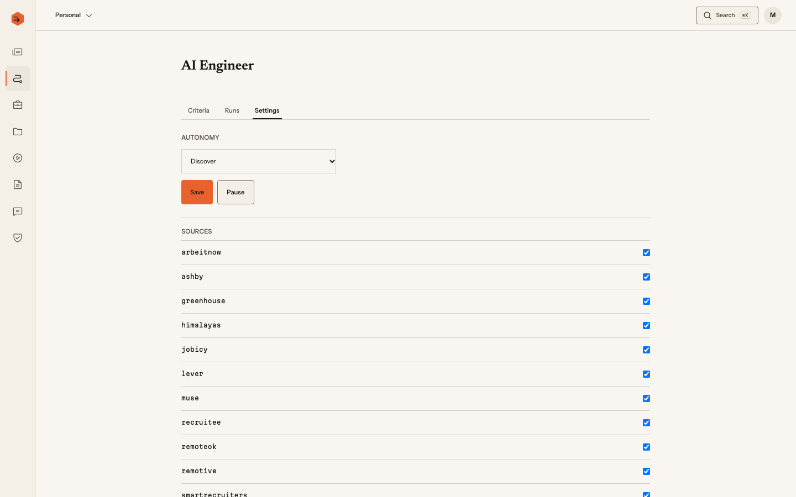 | 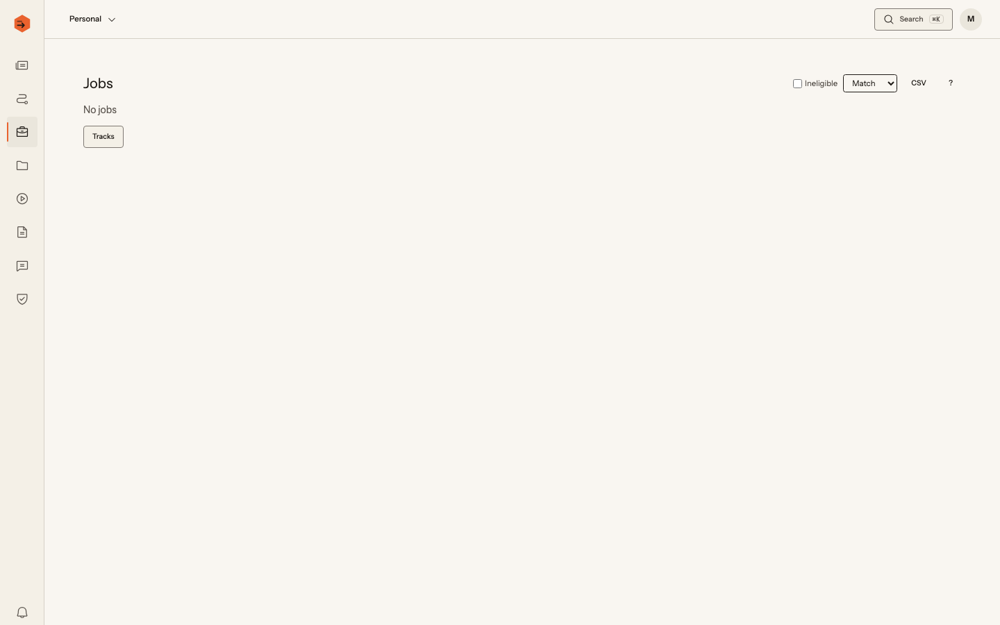 |

|                  Profile                   |                     Studio                      |
| :----------------------------------------: | :---------------------------------------------: |
| 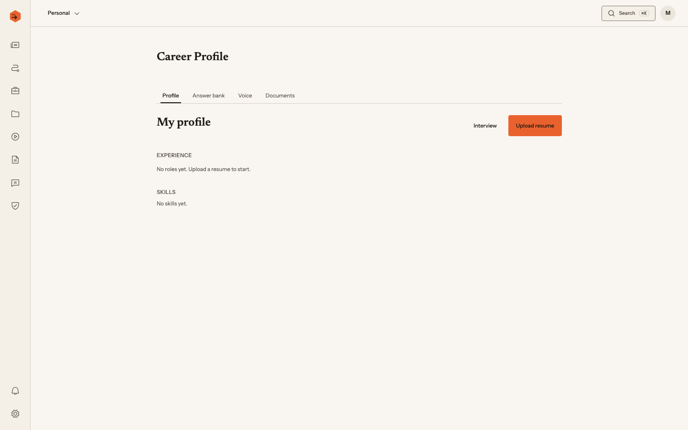 | 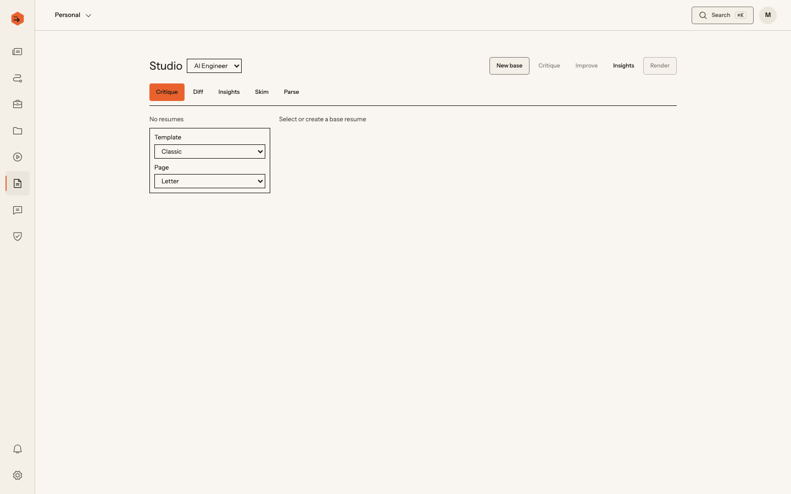 |

|                Applications (board)                 |                Applications (table)                 |
| :-------------------------------------------------: | :-------------------------------------------------: |
| 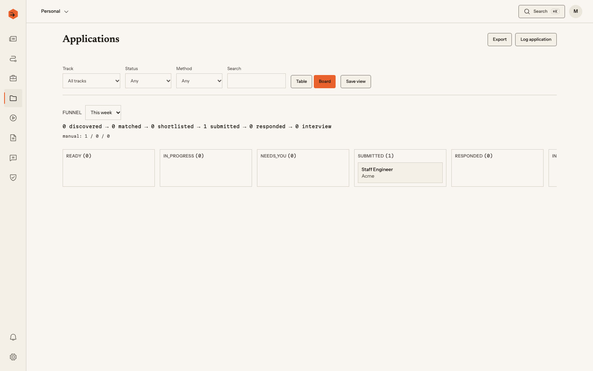 | 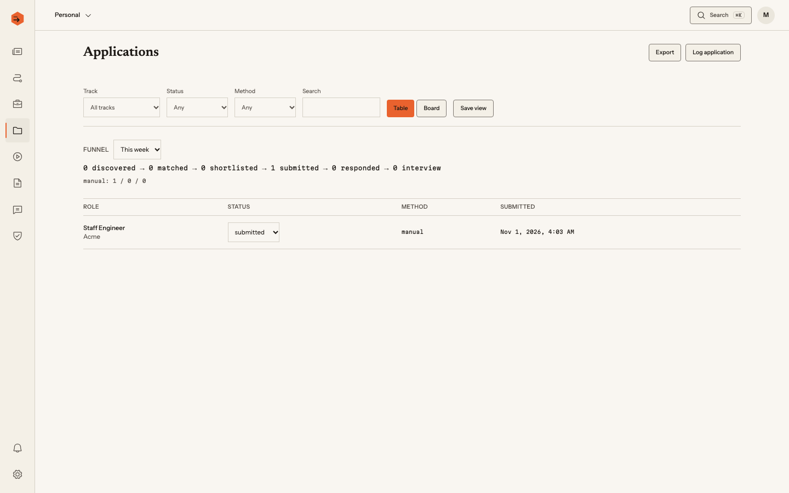 |

|                    Answer Desk                     |                  Safety                  |
| :------------------------------------------------: | :--------------------------------------: |
| 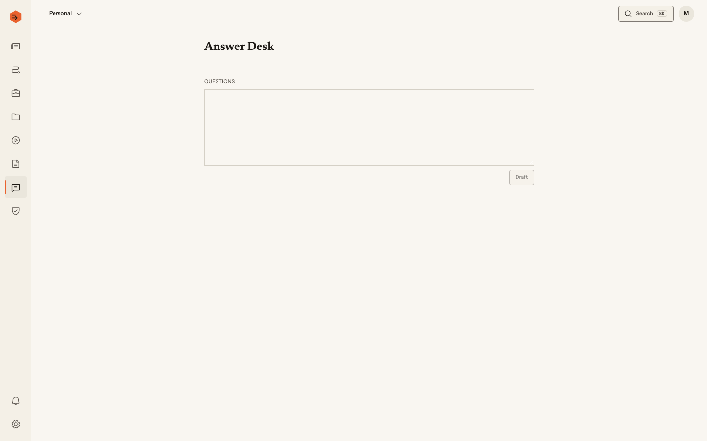 | 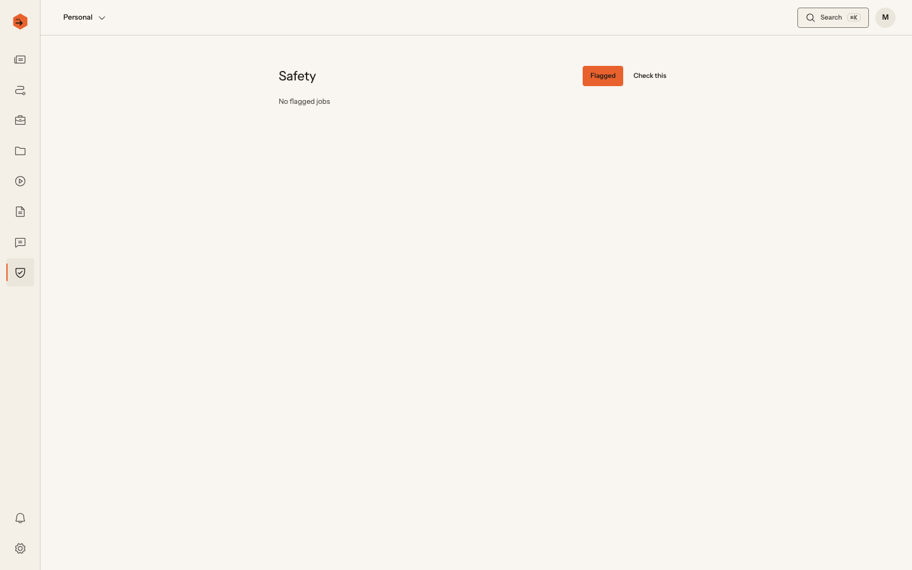 |

More captures and regenerate notes: [`docs/screenshots/README.md`](./docs/screenshots/README.md).

---

## Tech Stack

| Layer            | Technology                                                                                                                                                                                      |
| ---------------- | ----------------------------------------------------------------------------------------------------------------------------------------------------------------------------------------------- |
| Monorepo         | [pnpm](https://pnpm.io/) workspaces + [Turborepo](https://turbo.build/) (TS) · [uv](https://docs.astral.sh/uv/) (Python)                                                                        |
| Frontend         | [Vue 3](https://vuejs.org/) + [Nuxt 4](https://nuxt.com/) SPA · [Tailwind CSS 4](https://tailwindcss.com/) · [Reka UI](https://reka-ui.com/) · Phosphor · Vue Query · Pinia · VeeValidate + Zod |
| **Backend**      | [FastAPI](https://fastapi.tiangolo.com/) + Pydantic v2. Owns all business logic                                                                                                                 |
| Workflows        | [DBOS](https://www.dbos.dev/) durable steps, queues, and schedules (Postgres-backed; no Redis)                                                                                                  |
| ORM / migrations | [SQLAlchemy 2](https://www.sqlalchemy.org/) async + [Alembic](https://alembic.sqlalchemy.org/)                                                                                                  |
| **Database**     | [PostgreSQL 17](https://www.postgresql.org/) + [pgvector](https://github.com/pgvector/pgvector) + pg_trgm + **RLS**                                                                             |
| **AI**           | [PydanticAI](https://ai.pydantic.dev/), fastembed (local), BYO keys                                                                                                                             |
| Apply runner     | [Playwright](https://playwright.dev/) (Python) in `apps/runner`                                                                                                                                 |
| Extension        | [WXT](https://wxt.dev/) + Vue, shared `@kame/ui`                                                                                                                                                |
| Files            | Cloudflare R2 (MinIO locally), short-lived signed URLs                                                                                                                                          |
| Auth             | FastAPI JWT + refresh, Google OAuth, argon2; roles `owner \| admin \| member \| viewer`                                                                                                         |
| Design           | **Field Notes**: paper/ink + persimmon, Instrument Sans / Newsreader / Martian Mono                                                                                                             |

Full rationale: [`docs/tech-stack.md`](./docs/tech-stack.md). Product principles (truthful content, no evasion, human owns Submit): [`docs/prd.md`](./docs/prd.md).

---

## Getting Started

### Prerequisites

- [Node.js](https://nodejs.org/) (see [`.nvmrc`](./.nvmrc)) and [pnpm](https://pnpm.io/) 10+
- [uv](https://docs.astral.sh/uv/)
- [Docker](https://www.docker.com/) (Postgres+pgvector, MinIO, Mailpit)
- `jq`

### 1. Clone and install

```bash
git clone https://github.com/sprmke/kame-apply.git
cd kame-apply
pnpm install
uv sync --all-packages
pnpm run setup:ai-tooling   # once; Cursor / Claude Code / OpenCode links
```

### 2. Environment

```bash
cp apps/api/.env.example apps/api/.env
```

Local defaults work with Compose. Optional: LLM API keys for AI features. See [`apps/api/.env.example`](./apps/api/.env.example) and [`docs/architecture/deployment.md`](./docs/architecture/deployment.md).

### 3. Run locally

```bash
pnpm run dev:docker   # Postgres :5442, MinIO, Mailpit
pnpm run dev          # migrate, then API :8100 + web :3100
```

Open [http://localhost:3100](http://localhost:3100). API health: [http://localhost:8100/api/v1/health](http://localhost:8100/api/v1/health).

**VS Code / Cursor:** Terminal → Run Task for the same commands. `⇧⌘B` starts the full stack.

Quality gate before a PR: `pnpm run ci:quality`.

---

## Scripts

| Command                                              | Description                                        |
| ---------------------------------------------------- | -------------------------------------------------- |
| `pnpm run dev`                                       | Migrate + API + web (`./dev.sh`)                   |
| `pnpm run dev:docker` / `stop:docker`                | Local Postgres, MinIO, Mailpit                     |
| `pnpm run dev:api` / `dev:web`                       | One side only                                      |
| `pnpm run lint` / `format` / `type-check` / `build`  | Quality                                            |
| `pnpm run test`                                      | pytest (API, runner) + Vitest (web, ui, extension) |
| `pnpm run ci:quality`                                | Full CI gate                                       |
| `pnpm run db:migrate` / `db:reset:local` / `db:seed` | Database                                           |
| `pnpm run gen:api-client`                            | OpenAPI → `packages/api-client`                    |
| `pnpm run check:ai-tooling-sync`                     | Keep Cursor/Claude/OpenCode tooling aligned        |

Deploy and migrate scripts are documented in [`docs/architecture/deployment.md`](./docs/architecture/deployment.md). Production writes need an explicit unlock word in-session.

---

## Project structure

```text
apps/
  web/                 # Vue 3 + Nuxt 4 (UI only)
  api/                 # FastAPI: routers, services, models, AI, MCP
  runner/              # Playwright cloud apply worker
  extension/           # WXT + Vue side panel
packages/
  ui/                  # Field Notes components + tokens
  api-client/          # Generated OpenAPI TypeScript client
  py-core/             # Shared Python (adapters, utils)
docs/
  prd.md               # Authoritative product scope
  tech-stack.md        # Authoritative stack
  architecture/        # Overview, auth, RLS, deploy, …
  phases/              # Build plan (phases 0–20)
  guides/routes/       # Per-page behavior
  screenshots/         # README portfolio images
.agent/                # Canonical AI skills (symlinked into Cursor/Claude)
```

---

## Routes

| Route                    | Access | Description                               |
| ------------------------ | ------ | ----------------------------------------- |
| `/login`, `/register`    | Public | Auth                                      |
| `/`                      | Auth   | Today command center                      |
| `/tracks`, `/tracks/:id` | Auth   | Tracks, criteria, runs, settings          |
| `/jobs`                  | Auth   | Research board                            |
| `/profile/*`             | Auth   | Career Profile, answers, voice, documents |
| `/studio`                | Auth   | Resume Studio                             |
| `/tailor/:trackJobId`    | Auth   | Per-job tailor + Recruiter Lens           |
| `/applications`          | Auth   | Tracker (table / board)                   |
| `/answers`               | Auth   | Answer Desk                               |
| `/safety`                | Auth   | Flagged jobs & Check-this                 |
| `/notifications`         | Auth   | Inbox                                     |
| `/settings/*`            | Auth   | Workspace, AI keys, sources, integrations |
| `/legal/*`               | Public | Privacy, terms, extension disclosure      |

Full guides: [`docs/guides/routes/README.md`](./docs/guides/routes/README.md).

---

## Documentation

| Doc                                                                | Purpose                                          |
| ------------------------------------------------------------------ | ------------------------------------------------ |
| [`docs/prd.md`](./docs/prd.md)                                     | Product scope, features F1–F21, principles P1–P7 |
| [`docs/tech-stack.md`](./docs/tech-stack.md)                       | Technology choices and hosting                   |
| [`docs/architecture/overview.md`](./docs/architecture/overview.md) | System diagram, invariants, modules              |
| [`docs/phases/README.md`](./docs/phases/README.md)                 | Build plan and phase status                      |
| [`docs/design/design-system.md`](./docs/design/design-system.md)   | Field Notes visual identity                      |
| [`docs/README.md`](./docs/README.md)                               | Full documentation index                         |
| [`CLAUDE.md`](./CLAUDE.md)                                         | Always-loaded agent context                      |

**Status:** Eng phases 0–20 complete. Operator leftovers (dogfood, prod uptime): [`docs/phases/REMAINING.md`](./docs/phases/REMAINING.md).

---

## Design

**Field Notes**: paper and ink neutrals, persimmon accent, Instrument Sans / Newsreader / Martian Mono, Phosphor icons. Deliberately unlike the other Kame apps (no shadcn look, no Lucide, no teal). See [`docs/design/design-system.md`](./docs/design/design-system.md).

---

## License

Private for now. Record the decision here when made.

---

<p align="center">
  Built for job seekers who want better interviews, not louder spray-and-pray automation.
</p>
