# Kame Apply

**Find real jobs worldwide, strengthen your resume with live market evidence, tailor each application, and apply faster, while you stay in control of every irreversible step.**

A multi-tenant job-search workbench: one search per role, scheduled discovery across ATS boards and public feeds, match scoring, scam safety checks, a truthful resume studio and per-job tailoring, answer help, assisted apply through a browser extension or cloud runner, and a command center for the whole pipeline. Built as a **pnpm + Turborepo** (TypeScript) and **uv** (Python) monorepo: **Vue 3 + Nuxt 4** SPA, **FastAPI** (all business logic), **PostgreSQL 17** with **pgvector** and **RLS**, **DBOS** durable workflows, **PydanticAI**, and a **WXT** browser extension.

  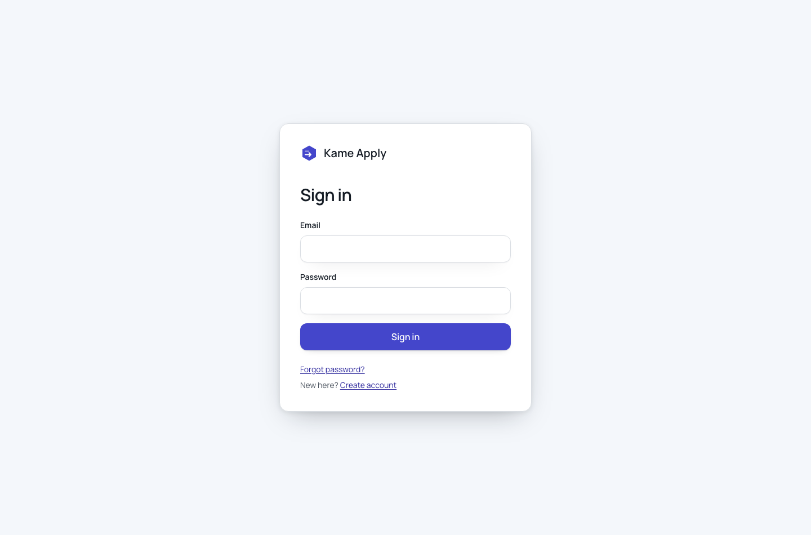

  <a href="#features">Features</a> ·
  <a href="#screenshots">Screenshots</a> ·
  <a href="#tech-stack">Tech Stack</a> ·
  <a href="#documentation">Documentation</a> ·
  <a href="#design">Design</a>

  
  
  
  
  
  
  
  
  
  
  

---

## Features

### Career Profile

- Upload resumes (PDF, DOCX, TXT) and portfolios; parse into structured facts with per-field confidence
- Guided profile interview to fill gaps (metrics, tools, scope, outcomes)
- **Answer bank** for forms: work authorization, notice period, salary, relocation, EEO defaults
- **Writing voice** from your own samples (emails, Slack, letters); free-text answers match your style
- Sensitive data (government IDs, bank details) is never stored

### Searches and criteria

- One **search** per role (AI Engineer, Product Manager, Nurse, Electrician, ...) with its own criteria, sources, schedule, autonomy, resume variant, and pipeline
- Describe the role in plain language, then edit structured chips and filters
- Preview of estimated matches; AI suggestions for synonyms, skills, and noise filters
- Filters for titles, skills, seniority, remote and hybrid work, salary, visa, company size, agencies, and industry-specific facets

### Job discovery and matching

- Scheduled pulls from company ATS APIs (Greenhouse, Lever, Ashby, Workable, ...), remote boards, RSS, schema.org career pages, forwarded email alerts, and extension clips
- Normalize and dedupe across sources; expire closed posts; grow a company directory from public signals
- Hard filters, rule score, embeddings, then LLM fit only for top candidates
- Per-job score, matched and missing skills, eligibility verdict, salary and seniority fit
- **Fit ledger** checks each requirement against your profile and shows the evidence, or says plainly that there is none

### Jobs board and safety

- Filterable research board: match score, risk badge, source, salary, location
- Shortlist, skip (trains ranking), hide company, mark applied, prepare, or open with assist
- **Risk levels** green, caution, and high risk with reasons; yellow and red pause automation
- **Check this** for recruiter messages and take-home links
- PII guard on form fields; sensitive values always stop for the human
- No CAPTCHA solvers, stealth plugins, or proxy rotation. A challenge hands control to you

### Resume studio and tailoring

- **Resume check**: ATS parseability, claims with proof, scanability, dates and titles, 6-second view, and what hiring software reads
- **What employers ask** from live postings, with market insights for your role
- Improve a base resume per search; every change is a diff with a reason
- **Per-job tailor**: map posting requirements to Career Profile evidence; gaps stay gaps
- ATS-safe PDF (Typst/RenderCV) and DOCX; optional cover letter in your voice

### Applying and answers

- Autonomy per search: find only, prepare, fill forms, or apply (opt-in and allowlisted ATS only)
- **Browser extension**: fill in your own session; LinkedIn, Indeed, and JobStreet autofill is opt-in
- **Cloud runner**: headless apply with durable checkpoints, live view, and takeover
- You click Submit unless the apply policy allows otherwise; never auto-submit on restricted platforms
- **Answer help**: paste application questions, draft in your voice, copy or save to the answer bank; restricted questions get notes only

### Tracker, replies, and people

- **Applications** as a table or board: funnel from discovered to interview, status, method, submitted date, notes, and next step
- **Replies**: paste an employer reply and accept its status suggestion
- **People I help**: keep profiles for people you are helping apply
- **Contacts**: add people you met while applying from a signature, profile, or CSV
- Needs you inbox for every decision that waits on a human

### Scheduling, AI, and integrations

- Per-search schedules, quiet hours, daily caps, run history, and source health
- Notification prefs: in-app, email digest, push, and Telegram
- Bring-your-own AI keys (Gemini, OpenAI, Anthropic, Groq, OpenRouter, Ollama) or a free provider, with budgets
- **Claude Agent Bridge**: MCP server and Claude Code plugin so your own Claude works on workspace data, with no credential relay

---

## Screenshots

|                  Sign in                   |                 Today                  |
| :----------------------------------------: | :------------------------------------: |
|  | 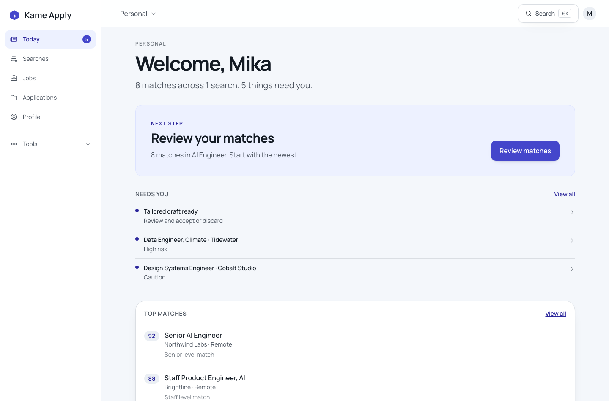 |

|                  Searches                  |                      Search overview                      |
| :----------------------------------------: | :-------------------------------------------------------: |
| 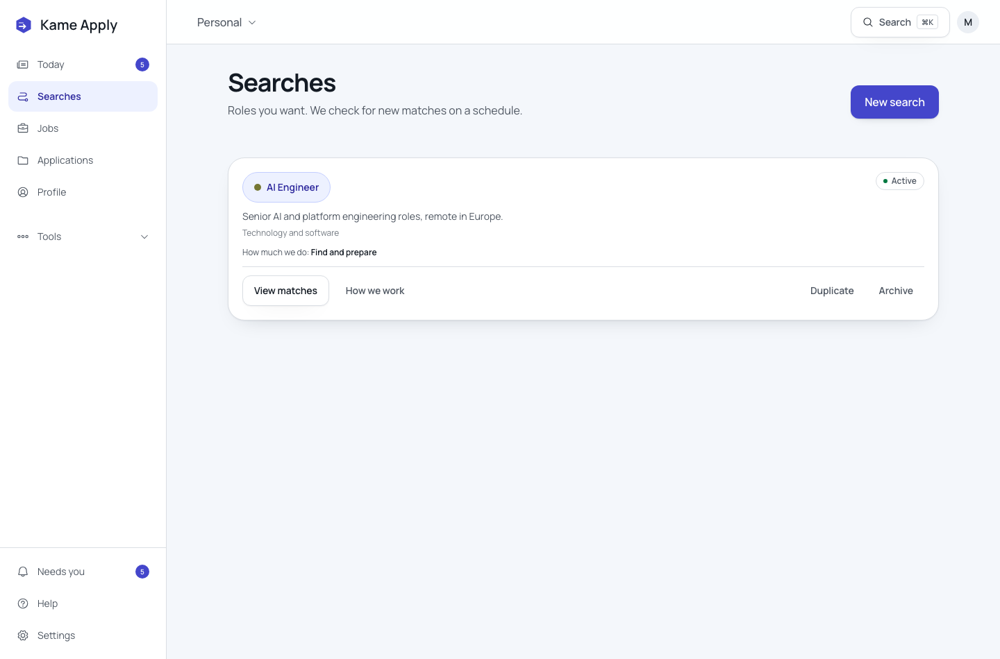 | 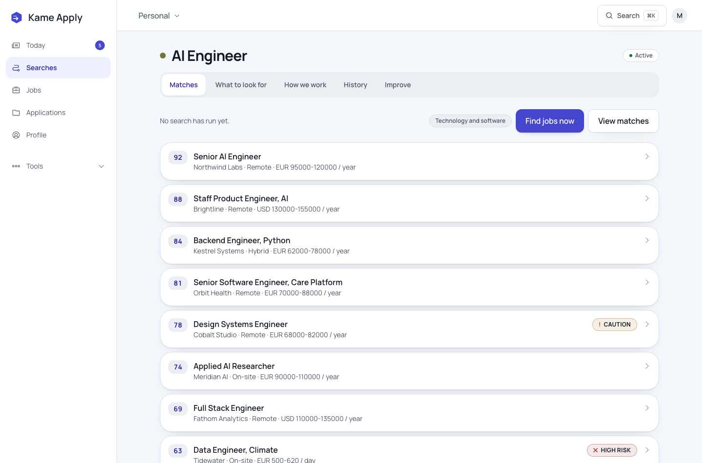 |

|                         How we work                         |                    Jobs                    |
| :---------------------------------------------------------: | :----------------------------------------: |
| 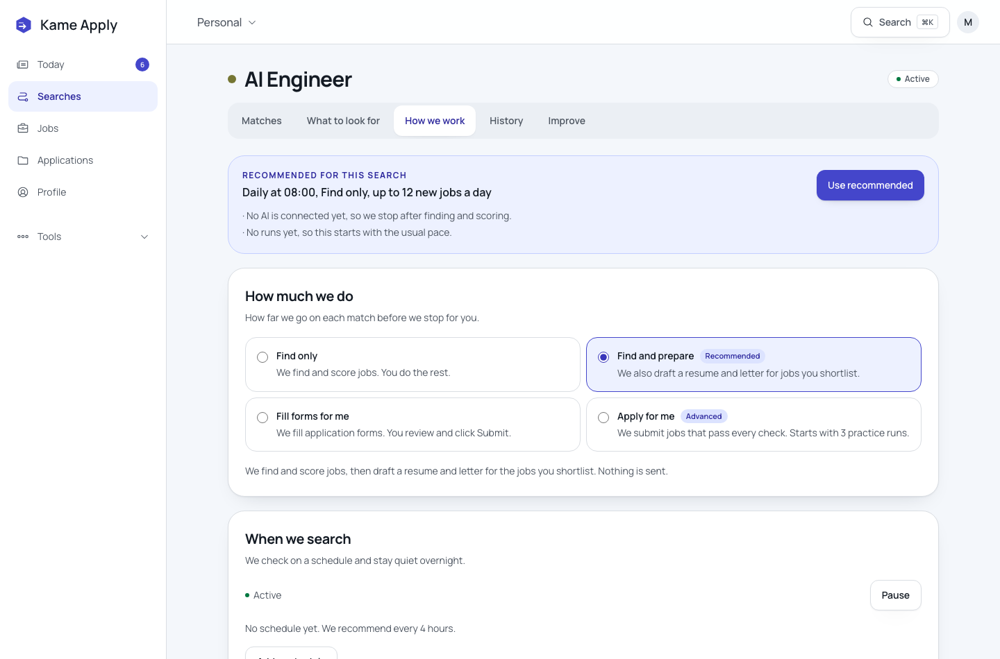 | 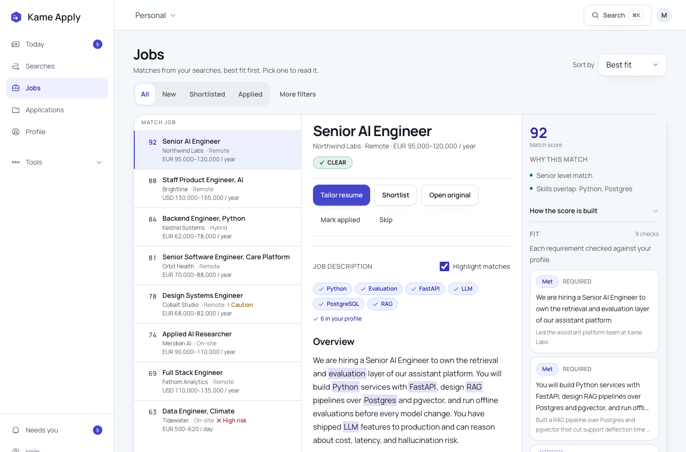 |

|                    Job reader                    |                      Profile                      |
| :----------------------------------------------: | :-----------------------------------------------: |
| 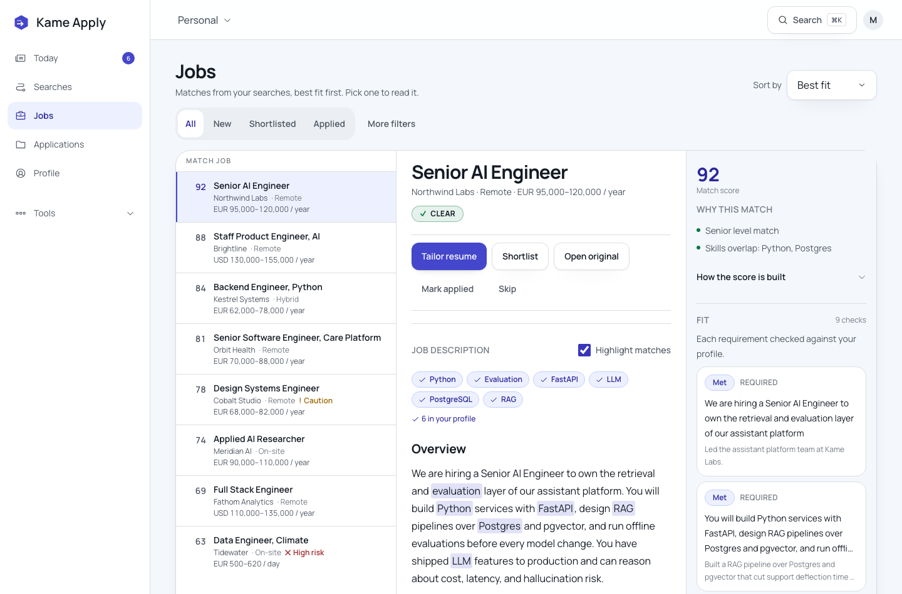 | 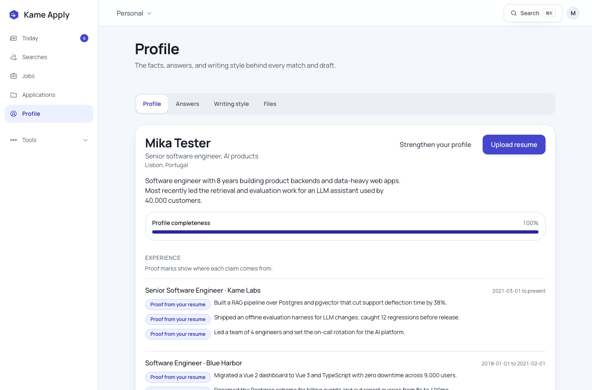 |

|                  Resume studio                  |                    Answer help                     |
| :---------------------------------------------: | :------------------------------------------------: |
| 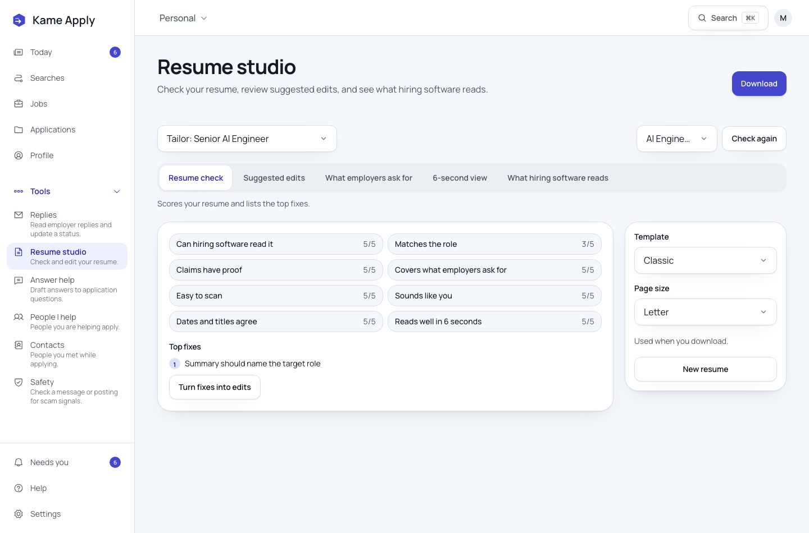 | 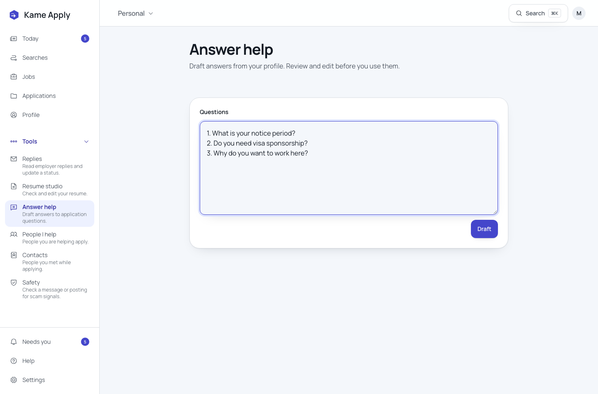 |

|                     Applications                     |                  Safety                  |
| :--------------------------------------------------: | :--------------------------------------: |
| 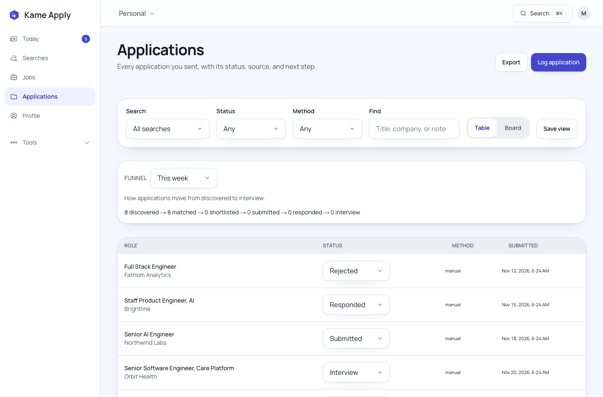 | 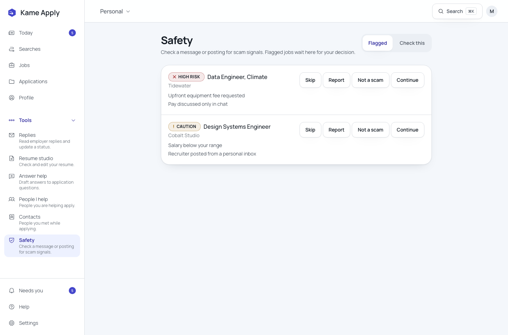 |

|                     Inbox                      |                    Connect AI                     |
| :--------------------------------------------: | :-----------------------------------------------: |
| 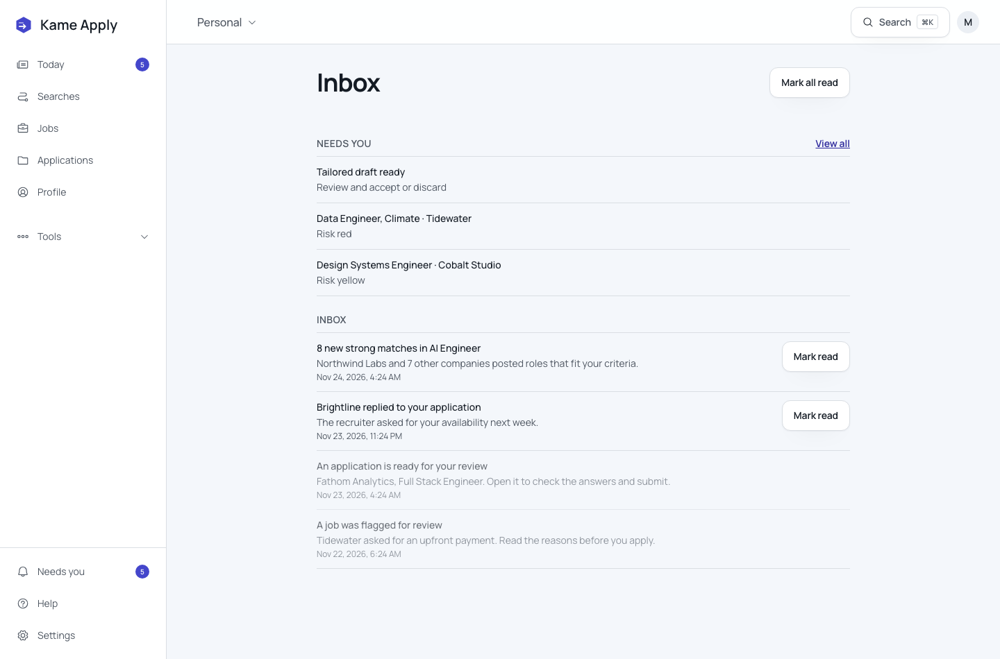 | 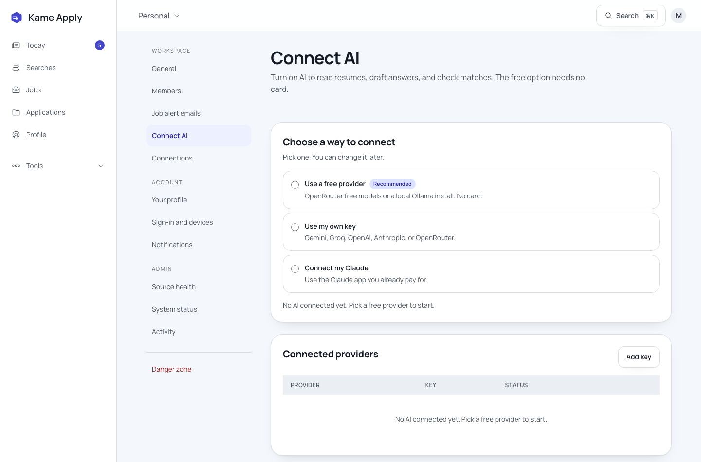 |

Captured at 1440px in light theme. Notes and regeneration steps: [`docs/screenshots/README.md`](./docs/screenshots/README.md).

---

## Tech Stack

| Layer            | Technology                                                                                                                                                                                      |
| ---------------- | ----------------------------------------------------------------------------------------------------------------------------------------------------------------------------------------------- |
| Monorepo         | [pnpm](https://pnpm.io/) workspaces + [Turborepo](https://turbo.build/) (TS) · [uv](https://docs.astral.sh/uv/) (Python)                                                                        |
| Frontend         | [Vue 3](https://vuejs.org/) + [Nuxt 4](https://nuxt.com/) SPA · [Tailwind CSS 4](https://tailwindcss.com/) · [Reka UI](https://reka-ui.com/) · Phosphor · Vue Query · Pinia · VeeValidate + Zod |
| **Backend**      | [FastAPI](https://fastapi.tiangolo.com/) + Pydantic v2. Owns all business logic                                                                                                                 |
| Workflows        | [DBOS](https://www.dbos.dev/) durable steps, queues, and schedules (Postgres-backed; no Redis)                                                                                                  |
| ORM / migrations | [SQLAlchemy 2](https://www.sqlalchemy.org/) async + [Alembic](https://alembic.sqlalchemy.org/)                                                                                                  |
| **Database**     | [PostgreSQL 17](https://www.postgresql.org/) + [pgvector](https://github.com/pgvector/pgvector) + pg_trgm + **RLS**                                                                             |
| **AI**           | [PydanticAI](https://ai.pydantic.dev/), fastembed (local), BYO keys                                                                                                                             |
| Apply runner     | [Playwright](https://playwright.dev/) (Python) in `apps/runner`                                                                                                                                 |
| Extension        | [WXT](https://wxt.dev/) + Vue, shared `@kame/ui`                                                                                                                                                |
| Files            | Cloudflare R2 (MinIO locally), short-lived signed URLs                                                                                                                                          |
| Auth             | FastAPI JWT + refresh, Google OAuth, argon2; roles `owner \| admin \| member \| viewer`                                                                                                         |
| Design           | **Signal**: cool canvas, white surfaces, indigo brand, Manrope                                                                                                                                  |

Full rationale: [`docs/tech-stack.md`](./docs/tech-stack.md). Product principles (truthful content, no evasion, human owns Submit): [`docs/prd.md`](./docs/prd.md).

---

## Documentation

| Doc                                                                | Purpose                                          |
| ------------------------------------------------------------------ | ------------------------------------------------ |
| [`docs/prd.md`](./docs/prd.md)                                     | Product scope, features F1–F21, principles P1–P7 |
| [`docs/tech-stack.md`](./docs/tech-stack.md)                       | Technology choices and hosting                   |
| [`docs/architecture/overview.md`](./docs/architecture/overview.md) | System diagram, invariants, modules              |
| [`docs/phases/README.md`](./docs/phases/README.md)                 | Build plan and phase status                      |
| [`docs/design/design-system.md`](./docs/design/design-system.md)   | Signal visual identity                           |
| [`docs/guides/routes/README.md`](./docs/guides/routes/README.md)   | Per-page behavior guides                         |
| [`docs/README.md`](./docs/README.md)                               | Full documentation index                         |
| [`CLAUDE.md`](./CLAUDE.md)                                         | Always-loaded agent context                      |

**Status:** Eng phases 0–20 complete. Operator leftovers (dogfood, prod uptime): [`docs/phases/REMAINING.md`](./docs/phases/REMAINING.md).

---

## Design

**Signal**: cool gray canvas, white surfaces, indigo brand, Manrope, Phosphor icons, soft elevation. Deliberately unlike the other Kame apps (no shadcn look, no Lucide, no teal). See [`docs/design/design-system.md`](./docs/design/design-system.md).

---

## License

Private for now. Record the decision here when made.

---

  Built for job seekers who want better interviews, not louder spray-and-pray automation.

